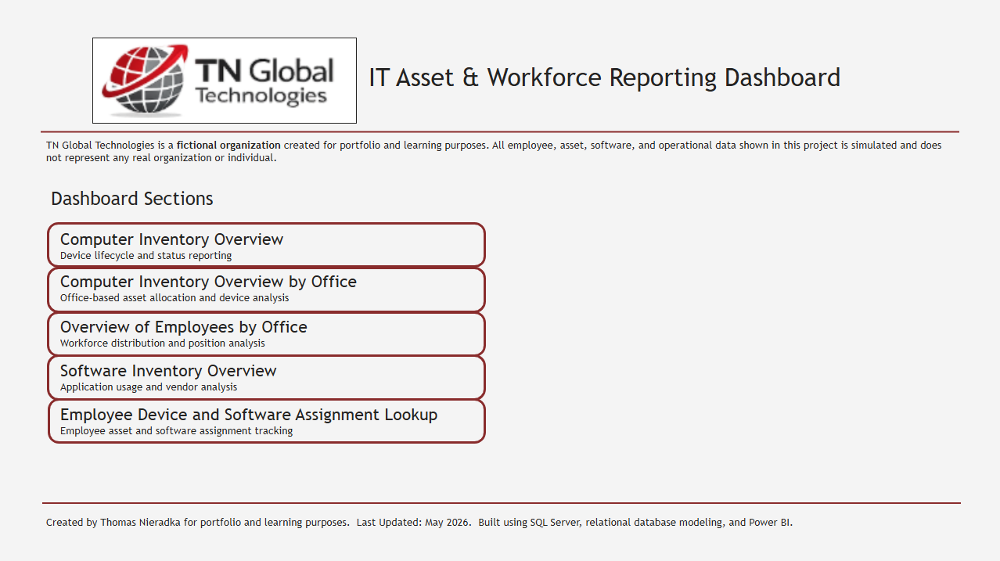

# Power BI Computer Inventory

Power BI dashboards built from a SQL Server inventory database to demonstrate data modeling, transformation, reporting, and visualization for IT asset analysis.

## 1. Overview

This independent portfolio project uses the database developed in the [SQL Computer Inventory repository](https://github.com/tjnieradka/SQL-Computer-Inventory) to create interactive Power BI reports. It demonstrates how relational inventory data can be transformed into reports covering computers, employees, offices, and software assignments.

The main objectives are to connect to SQL Server, prepare and model data, and create interactive reports using filters and slicers.

## 2. Technologies and Tools

- Microsoft Power BI Desktop
- Microsoft SQL Server Express 2022
- SQL Server Management Studio (SSMS) and T-SQL
- Windows 11

## 3. Documentation and Project Files

### Documentation

1. [Connection Details and Data Setup](data-source/connection-details-and-data-setup.md)
2. [Power BI Fundamentals](docs/powerbi-fundamentals.md)
3. [Data Modeling](docs/data-modeling.md)
4. [Report Design](docs/report-design.md)

### Power BI Project

- [Computer Inventory Power BI Report (.pbix)](pbix/computer-inventory.pbix) — Power BI Desktop project file.

### Screenshots

- [Dashboard Overview](output/dashboard-screenshots/00-dashboard-overview.png) — Preview of the completed report.
- [Dashboard Screenshots](output/dashboard-screenshots/) — Report pages and filtered views.
- [Setup Screenshots](output/setup-screenshots/) — Connection, Navigator, Query Editor, and model views.

## 4. Data Model and Dashboard Features

The report imports data from the locally hosted SQL Server Express `ComputerInventory` database. Its model includes relationships among computers, employees, software, and associated lookup tables.

The dashboard contains five report areas:

1. Computer inventory overview
2. Computer inventory by office
3. Employee overview by office
4. Software inventory overview
5. Employee device and software lookup

These reports support exploration of asset assignments, office distributions, software installations, and inventory status through interactive filtering.

## 5. Project Scope

This is an educational portfolio project using a fictional IT inventory scenario, not a production asset-management system. The focus is on importing relational data, understanding model relationships, and presenting operational information in Power BI. The database design and supporting SQL scripts are documented separately in the [SQL Computer Inventory repository](https://github.com/tjnieradka/SQL-Computer-Inventory).

## 6. References and Learning Resources

- [Microsoft Learn — Power BI Documentation](https://learn.microsoft.com/en-us/power-bi/)
- [Microsoft Learn — Power Query Documentation](https://learn.microsoft.com/en-us/power-query/)
- [Microsoft Learn — Power BI Data Modeling](https://learn.microsoft.com/en-us/power-bi/transform-model/)
- [SQL Computer Inventory — Companion Repository](https://github.com/tjnieradka/SQL-Computer-Inventory)
